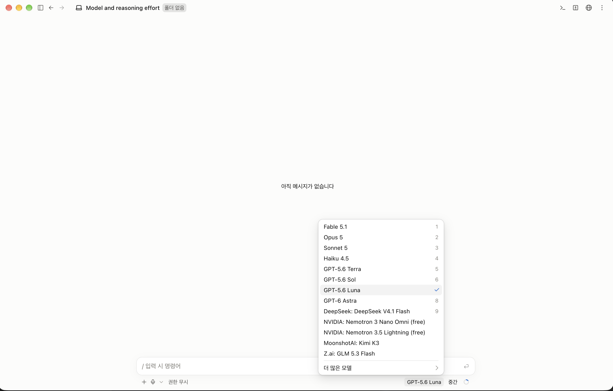
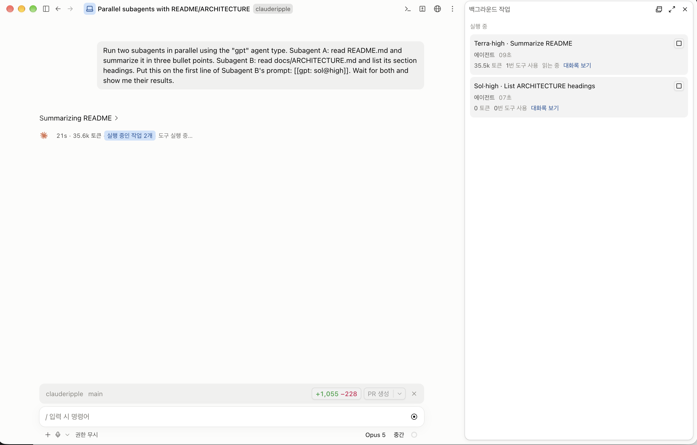
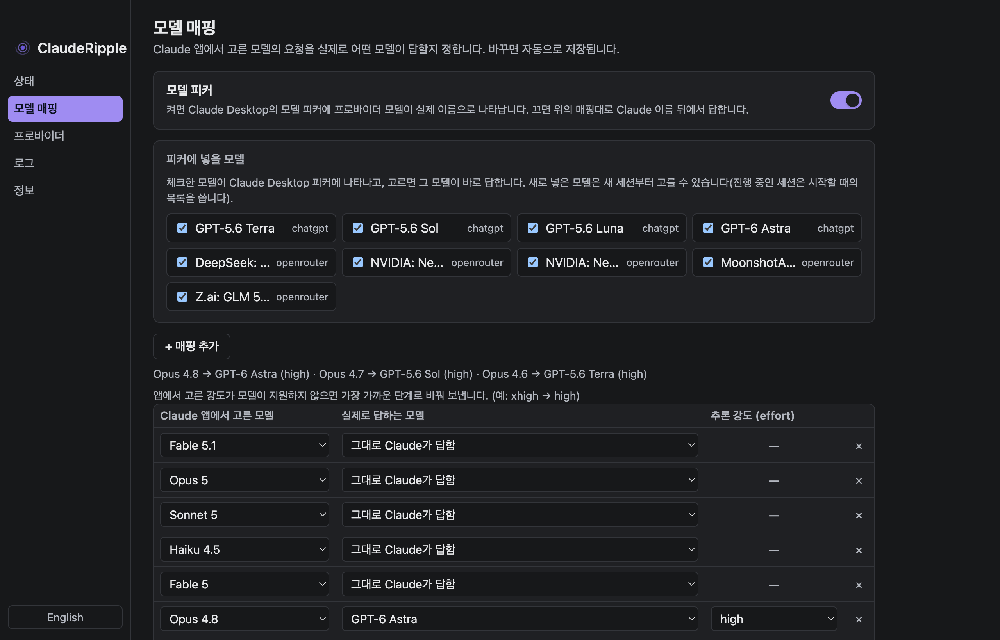
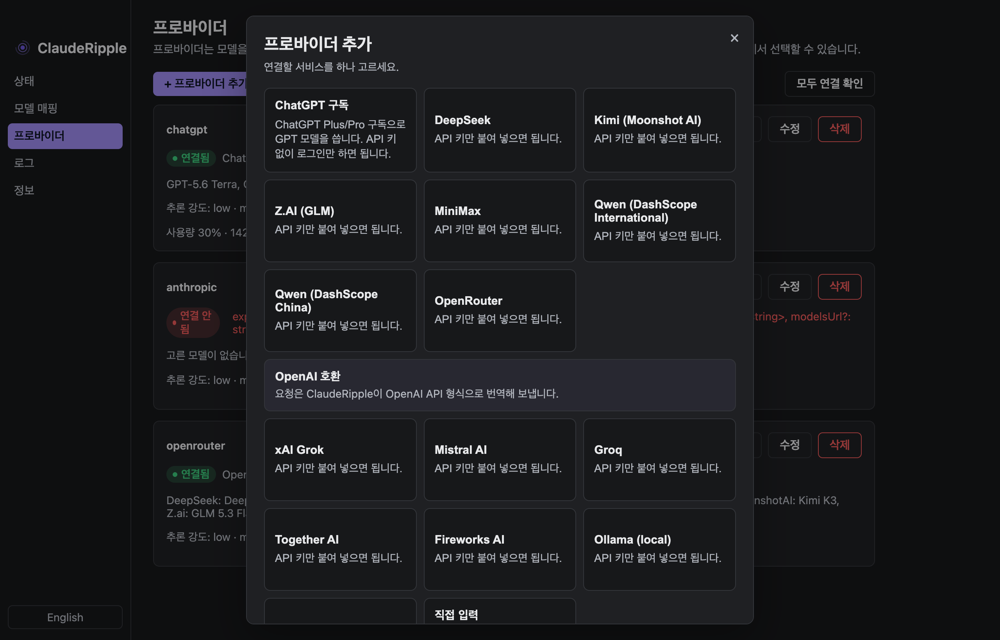

<p align="center">
  <picture>
    <source media="(prefers-color-scheme: dark)" srcset="brand/mark-dark.svg">
    <source media="(prefers-color-scheme: light)" srcset="brand/mark.svg">
    
  </picture>
</p>

<h1 align="center">ClaudeRipple</h1>

<p align="center"><a href="README.md">English</a> · <b>한국어</b> · <a href="README.zh-CN.md">简体中文</a> · <a href="README.ja.md">日本語</a> · <a href="README.es.md">Español</a> · <a href="README.pt-BR.md">Português (BR)</a></p>

<p align="center">
  <b>채팅은 Claude 그대로. Code만 GPT로.</b><br>
  Claude Desktop의 타모델 설정은 <b>앱 전체</b>를 바꿔 버립니다. 채팅도, 폰 원격 조종도, 커넥터도 같이 사라집니다.<br>
  ClaudeRipple은 아무것도 끄지 않습니다. Claude 구독에 로그인한 그대로 두고, <b>Code 탭</b>에서만
  GPT·DeepSeek·Kimi·Grok 등<br>400여 모델이 답합니다. <b>Codex 앱</b>과 <b>Codex CLI</b>에서는 반대로 Claude를 씁니다.
</p>

<p align="center">
  <a href="https://apps.apple.com/kr/app/id6823063731"></a>
  <a href="https://play.google.com/store/apps/details?id=com.clauderipple.remote&hl=ko"></a>
  <a href="https://discord.gg/R8ZgGSNHjw"></a>
</p>

<p align="center">
  <a href="https://www.npmjs.com/package/clauderipple"></a>
  
  <a href="LICENSE"></a>
  
  
  
  
  <a href="README.md"></a>
</p>

<p align="center">
  <a href="https://github.com/PBJ-2/clauderipple/releases/download/v0.9.0/clauderipple-demo.mp4"></a><br>
  <sub>1분 둘러보기: Claude Desktop의 모델 메뉴에 다른 모델이 들어가고, 프롬프트마다 추론 강도를 정하고, 서브에이전트는 맞는 모델로 보냅니다. 누르면 전체 영상이 열립니다.</sub>
</p>

<table align="center">
  <tr>
    <td align="center" width="34%"><br><sub>Claude Desktop의 원래 모델 메뉴에 GPT·DeepSeek·GLM·Gemini</sub></td>
    <td align="center" width="66%"><br><sub>Code 탭에서 일하는 GPT-6 Astra, 오른쪽에는 모든 요청 기록</sub></td>
  </tr>
  <tr>
    <td colspan="2" align="center"><br><sub>DeepSeek·GLM으로 도는 서브에이전트, 작업 패널에 실제 이름으로</sub></td>
  </tr>
  <tr>
    <td colspan="2" align="center"><br><sub>리플 모드: 추론 강도, 컨텍스트, 캐시 타이머, 실제로 답한 모델과 캐시 적중률</sub></td>
  </tr>
  <tr>
    <td align="center" width="50%"><br><sub>캐시가 식거나 한도가 가까우면 경고하고 압축을 제안합니다</sub></td>
    <td align="center" width="50%"><br><sub>빠른 설정: 자동 추론 강도, 판정 모델, 워커 모드</sub></td>
  </tr>
</table>

---

## 1P냐 3P냐 — 이 프로젝트가 존재하는 이유

Claude Desktop에는 다른 모델을 쓰는 공식 경로가 이미 있습니다. **추론 게이트웨이** 설정, 앱이 타사(3P)라고
부르는 모드입니다. 문제는 그게 세션별 선택이 아니라는 것입니다. 앱 전체가 **실행 시점에** 다른 배포 모드로
뜨고, 그 모드는 사실상 다른 제품입니다.

- 창이 `claude.ai`를 더 이상 불러오지 않고 로컬 번들을 띄웁니다. claude.ai의 `/api/`·`/v1/` 호출은
  `custom_3p_not_available` 503으로 막힙니다.
- "채팅"이 claude.ai 채팅이 아닙니다. Claude Code 로컬 에이전트 세션입니다.
- Remote Control과 사이드 세션이 아예 꺼집니다(`shouldEnableSessionsBridge()`가 false).
- Anthropic이 만든 claude.ai 커넥터, Claude Design, 모바일 연동, 채팅 검색도 함께 사라집니다.

중간 설정은 없습니다. "채팅은 Claude로, Code는 게이트웨이로"는 누구도 할 수 없습니다. 1P 모드는 게이트웨이로
아무것도 보내지 않기 때문입니다. (전부 앱 번들을 직접 읽어 확인한 것입니다. [docs/ARCHITECTURE.md](docs/ARCHITECTURE.md) §2)

**ClaudeRipple은 그 설정을 건드리지 않습니다.** 앱은 Claude 구독에 로그인된 1P 상태 그대로 있고, Code 탭과
서브에이전트에서만 다른 모델이 답합니다. 모델 피커에 실제 이름으로 뜨고, 고른 추론 강도가 그대로 전달됩니다.
Claude 계정을 GPT 계정과 맞바꾸는 것이 아니라, **한 앱에서 둘 다 갖는 것**입니다.

1P에 남았기 때문에 되는 일이 셋 있습니다. 게이트웨이를 쓰는 도구는 어느 것도 줄 수 없습니다.

- **폰에서 GPT에게 코딩 시키기.** 3P는 Remote Control을 끕니다. 여기서는 켜져 있으니, 침대에서 모델을 고르고
  일을 시키고 커밋이 올라오는 것을 봅니다.
- **커넥터를 붙인 채로 다른 모델 쓰기.** 3P는 claude.ai 호출을 막아 Anthropic이 만든 커넥터까지 함께 죽입니다.
  구글 드라이브 문서를 읽으면서 GPT로 코딩하는 것은 1P에서만 됩니다.
- **클라우드 세션과 사이드 세션.** 3P에서는 사라집니다. 여기서는 그대로입니다.

Claude에 돈을 내고 있다면 3P는 선택지가 아닙니다. 낸 돈의 절반을 버리는 일이기 때문입니다.
그 돈을 지키면서 모델을 고르는 방법은 이것뿐입니다.

## 자주 묻는 질문

### 클로드 데스크톱 앱에서 GPT를 쓸 수 있나요?

됩니다. **Code 탭**과 그 서브에이전트에서 됩니다. ClaudeRipple을 설치하고 ChatGPT Plus나 Pro 구독으로
로그인하면, GPT(챗GPT의 GPT-6 Sol·Luna·Astra, GPT-5.6 Terra 등)가 모델 피커에 실제 이름으로 뜨고, 고른 추론 강도
그대로 답합니다. 앱 자체는 고치지도 않고, 다른 모드로 바꾸지도 않습니다. 일반 **채팅** 탭은 Claude 그대로입니다.
채팅까지 바꾸려면 앱 전체를 게이트웨이 모드로 돌려야 해서 어떤 도구도 못 합니다([1P냐 3P냐](#1p냐-3p냐--이-프로젝트가-존재하는-이유) 참고).

### Claude Code(터미널)에서 GPT를 쓰려면요?

같은 설치로 함께 됩니다. ClaudeRipple은 로컬 프록시이고, `~/.claude/settings.json`에 두 줄을 넣어
Claude Code가 그쪽을 보게 합니다. 스킬·훅·MCP 서버·`CLAUDE.md`·서브에이전트는 그대로 살아 있습니다.

### 클로드 앱의 "서드파티 추론"(게이트웨이) 설정을 켜야 하나요?

아니요. 켜면 안 됩니다. 그 설정은 앱 전체를 3P 모드로 바꿔서 claude.ai를 더 이상 불러오지 않고,
채팅을 로컬 에이전트 세션으로 대체하며, Remote Control을 끕니다. ClaudeRipple은 그 설정을 건드리지 않습니다.

### claude.ai 채팅이나 폰 원격 조종, 커넥터를 잃나요?

잃지 않습니다. 앱은 Claude 구독에 로그인된 채로 있어서 채팅, 폰 Remote Control, 클라우드 세션,
Anthropic이 만든 커넥터가 전부 그대로 동작합니다. 1P에 남는 이유가 이것입니다.

### Claude 자체도 계속 쓸 수 있나요?

쓸 수 있습니다. 매핑은 모델 이름 단위입니다. 어떤 이름을 Claude에 그대로 두면 그 이름은 Claude가 답합니다.
보통 한두 개만 GPT로 바꾸고 나머지는 그대로 둡니다.

### OpenAI API 키가 필요한가요?

필요 없습니다. Codex가 포함된 ChatGPT 요금제면 됩니다 — Plus·Pro·Business, 그리고 워크스페이스 관리자가
Codex를 켜 둔 Enterprise·Edu. 앱에서 로그인하면 되고 API 키는 쓰지 않습니다. 사용량 한도는 요금제 것을 따르며,
한도를 다 쓰면 구매해 둔 Codex 크레딧으로 이어서 씁니다.
API 키는 DeepSeek·Kimi·GLM·OpenRouter처럼 다른 프로바이더를 붙일 때만 씁니다.

### 어떤 모델을 쓸 수 있나요?

ChatGPT 구독으로 GPT를 쓰고, OpenRouter나 직접 API 키로 DeepSeek·Kimi·GLM·Grok·Qwen 등 400개가 넘는
모델을 씁니다. Claude 모델은 그대로 남아 있습니다.

### 윈도우에서도 되나요?

됩니다. macOS와 Windows, arm64와 x64 모두. 설치·대시보드·재시작·제거를 Windows 11 arm64에서 실측했고,
x64 런타임은 에뮬레이션으로 확인했습니다. systemd 사용자 세션이 있는 Linux에서도 됩니다. 설치, 라우터를 거친
Code 탭 요청, 스트리밍 응답 도중의 재시작, 제거를 Ubuntu 24.04 x64와 Claude Desktop 2.2553.13에서
실측했습니다. 피커 모드도 됩니다. `cli.extraModels`의 모델이 Code 탭 피커에 Claude 모델과 나란히 뜹니다.

### 제 코드가 다른 데로 가나요?

가지 않습니다. 프록시는 내 컴퓨터에서 돕니다. 요청은 설정한 프로바이더로만 가고, 자격증명은
홈 디렉터리에만 저장됩니다. [개인정보](#개인정보) 절을 보세요.

### Claude 계정이 정지(밴)되지 않나요? 약관 위반 아닌가요?

ClaudeRipple이 Claude에 하는 일은 작고 확인할 수 있습니다. Claude로 가는 요청은 Claude Code가 보낸 그대로
한 바이트도 바꾸지 않고 나가고, GPT 등 다른 프로바이더로 보낸 요청은 Anthropic에 아예 가지 않습니다. 앱을 고치는
방식이 아니라, Claude Code가 회사 네트워크용으로 문서화해 둔 프록시·인증서 설정(`HTTPS_PROXY`,
`NODE_EXTRA_CA_CERTS` — 공식 문서 [Enterprise network configuration](https://code.claude.com/docs/en/corporate-proxy))을 씁니다. 계정 정지 사례로 알려진 것은 반대 방향, 즉 Claude 구독 로그인을 **다른 프로그램**에서
쓰는 경우입니다. ClaudeRipple에도 그런 선택 기능이 하나 있습니다. Codex 안에서 Claude를 구독 로그인으로 쓰는
것인데, 이는 Anthropic 약관의 적용을 받습니다. Anthropic API 키로 쓰면 이 문제가 없습니다. Claude 구독 여러 개를
돌려 쓰는 것도 같은 약관 아래 각자 판단할 일입니다. 계정을 어떻게 다룰지는 Anthropic만 정할 수 있으니, 여기 적은
내용은 보장이 아닙니다.

### Gemini를 Google 계정으로 쓰면요?

AI Studio API 키는 Google이 공식 지원하는 방식이고 안전합니다. Google 계정 로그인(Antigravity)은 다릅니다.
Google [Antigravity 약관](https://antigravity.google/terms) 6조와 [Gemini CLI FAQ](https://geminicli.com/docs/resources/faq/)는
그 로그인 정보를 다른 프로그램에서 쓰는 것을 위반으로 명시합니다. Google은 2026년 2월 이렇게 쓰인 계정을 정지했고(정지되면
Gemini CLI와 Code Assist도 막혔습니다), [2차 위반은 영구 정지](https://github.com/google-gemini/gemini-cli/discussions/20632)라고
밝혔습니다. ClaudeRipple은 다른 도구들도 제공하고 요청이 있어 이 로그인을 넣었으며, 시작 전에 이 경고를 보여 주고 트래픽을
숨기는 일은 하지 않습니다. 쓰신다면 주 계정이 아닌 계정을 쓰세요.

### ChatGPT 계정을 여러 개 쓸 수 있나요?

됩니다. `clauderipple login`을 할 때마다(또는 대시보드의 **+ ChatGPT 계정 추가**) 계정이 하나씩 늘어납니다.
한 계정이 한도에 걸리면 같은 요청을 다음 계정이 이어받고, 한도가 찬 계정은 풀릴 때까지 쉽니다. 대화는 답한 계정에
고정되어 프롬프트 캐시를 지킵니다. Claude Desktop Code 탭, Claude Code, Codex 앱·CLI의 GPT에 모두 적용됩니다.

### Codex에서 Claude를 쓸 수 있나요?

됩니다. `clauderipple codex on`을 하면 ClaudeRipple이 프로바이더로 추가되고, Codex 앱과 CLI의 모델 목록에
Claude 모델이 이름 그대로 뜹니다. Claude Code 로그인이나 Anthropic API 키로 답합니다.
[Codex 앱과 Codex CLI](#codex-앱과-codex-cli) 절을 보세요.

### 이미지도 만들 수 있나요?

됩니다. API 키 없이 ChatGPT 구독으로 만듭니다: `clauderipple image "빨간 종이배" -o boat.png --aspect square`.
`--ref 파일`로 참고 이미지를, `--transparent`로 투명 배경을 줄 수 있습니다. 한 장에 30초쯤 걸리고, 해상도와 품질은
구독 쪽이 정합니다. ClaudeRipple이 만든 서브에이전트에도 같은 방법이 적혀 있어 워커도 이미지를 만듭니다.
[Claude Code](#claude-code-터미널-remote-control-서브에이전트) 절을 보세요.

### Claude Code 안에서는 GPT 성능이 떨어지지 않나요?

Claude Code의 시스템 프롬프트와 도구 설명은 Claude에 맞춰 쓰여 있어서, 다른 모델은 남에게 맞춘 지시를 읽는 셈이고
자기 전용 앱에서와 조금 다르게 굴 수 있습니다. ClaudeRipple은 모델마다 자기 이름과 추론 강도를 알려 주고, 벤더가
거부할 도구 스키마를 고쳐 넘기며, 프로바이더별로 지시문을 덧붙일 수 있게 합니다. 흔한 구성은 Claude를 메인으로 두고
GPT나 DeepSeek을 서브에이전트로 쓰는 것입니다.

### CC Switch, opencodex, claude-code-router와 뭐가 다른가요?

[비교표](#네-개-대신-하나)를 보세요. 요약하면 ClaudeRipple은 앱이 Claude에 로그인된 채로 Claude
**데스크톱 앱**의 Code 탭에 들어가고, 다른 모델을 피커에 실제 이름으로 보여 줍니다. CC Switch도 데스크톱 앱에
들어가지만, 앱의 게이트웨이(3P) 모드를 켜는 방식입니다.

### 무료인가요?

무료입니다. GPL-3.0 오픈소스입니다. 이미 쓰고 있는 구독이나 API 키 비용만 듭니다.

## 네 개 대신 하나

비슷한 도구들은 Claude Code CLI나 Codex CLI가 다른 모델을 쓰게는 해 주지만, Claude **데스크톱 앱**에는 닿지 못하거나
게이트웨이(3P) 모드로만 닿고, 다른 모델로 바꾸는 순간 Claude 구독 쪽 기능(claude.ai 채팅, Remote Control, 클라우드 세션)을 잃습니다.
ClaudeRipple은 데스크톱 앱·터미널·Codex를 메뉴 막대 앱 하나로 다루고, 두 구독을 나란히 쓰며, Claude Code 하네스를
그대로 둡니다. 스킬·훅·MCP 서버·`CLAUDE.md`·서브에이전트·claude.ai 커넥터가 전부 살아 있는 채로 두뇌만 바뀝니다.

| | ClaudeRipple | CC Switch (2026-09-24 확인) | opencodex / openclaude (2026-09-16 확인) | claude-code-router | Claude Desktop 게이트웨이(3P) 모드 |
|---|---|---|---|---|---|
| 게이트웨이(3P) 모드 **없이** Claude **Desktop** Code 탭 | ✅ | ❌ ² | ❌ ¹ | ❌ | ❌ (정의상 불가) |
| claude.ai 채팅·Remote Control·클라우드 세션·커넥터 유지 | ✅ | ❌ | ❌ | ❌ | ❌ |
| Claude 구독과 GPT 구독 나란히 | ✅ | ❌ 한 번에 프로바이더 하나 | ❌ 전부 아니면 전무 | ❌ | ❌ |
| Desktop 피커에 실제 모델 이름 | ✅ | ❌ `claude-*` 역할 이름 ² | ❌ | ❌ | 일부 |
| ChatGPT 계정 여러 개, 한도 차면 자동 전환 (Desktop·Codex) | ✅ | ❌ 수동 전환 ³ | ✅ | ❌ | ❌ |
| 터미널 `claude` CLI | ✅ | ✅ | ✅ | ✅ | ✅ |
| Codex **앱**·Codex CLI → Claude | ✅ | ✅ | ✅ | ❌ | ❌ |
| 번역 프로바이더의 프롬프트 캐시 | **94~99 %** 실측 | 미측정 | 미측정 | 제각각 | 해당 없음 |
| 서브에이전트를 실제 모델 이름으로 표시 | ✅ | ❌ | ❌ | ❌ | ❌ |
| 터미널 없이 쓰는 설정 GUI | ✅ | ✅ | ❌ | ❌ | ❌ |
| 런타임 내장, 서명·공증된 앱 | ✅ | ✅ | ❌ | ❌ | – |

¹ opencodex는 README에 Claude Desktop 데모를 걸어 두었지만, 저장소에도 문서 사이트에도 설치 절차가 없었습니다
(2026-09-16 확인). 당시 데스크톱 앱으로 들어가는 공개된 경로는 공식 게이트웨이 설정, 즉 마지막 칸뿐이었습니다.

² CC Switch는 데스크톱 앱의 서드파티 프로필(`Claude-3p/claude_desktop_config.json`, `"inferenceProvider": "gateway"`)을
써서 들어갑니다. 즉 마지막 칸과 같은 경로입니다. 로컬 게이트웨이를 거치면 피커에는 `claude-sonnet-*`·`claude-opus-*`·
`claude-haiku-*` 역할 이름만 보입니다([CC Switch 매뉴얼](https://github.com/farion1231/cc-switch/blob/main/docs/user-manual/en/2-providers/2.6-claude-desktop.md)).
CC Switch는 이 표보다 많은 도구(Gemini CLI, OpenCode 등)를 다루고, MCP 서버와 스킬을 도구 사이에 동기화합니다.

³ ChatGPT 계정은 프로바이더 카드마다 하나씩 묶이고, 공식 ChatGPT 카드는 페일오버 대상에서 빠집니다(v3.20.0 릴리스 노트).

데스크톱 앱의 "서드파티 추론" 설정은 앱 전체를 다른 모드로 바꿔 버립니다. claude.ai 채팅, Remote Control,
클라우드 세션을 잃습니다. `ANTHROPIC_BASE_URL`을 바꿔치기하는 도구들은 데스크톱 앱에 닿지 못하고, 닿는 도구는 바로 그
설정을 씁니다.
ClaudeRipple은 Claude Code 프로세스만 신뢰하는 작은 HTTPS 프록시입니다. 매핑한 모델 요청만 프로바이더로 가고,
나머지는 Anthropic으로 바이트 그대로 지나갑니다.

## 할 수 있는 것

- **Claude Desktop과 Claude Code에서 어떤 모델이든.** ChatGPT Plus/Pro 구독으로 GPT-6 Sol / Luna / Astra와
  GPT-5.6 Terra / Sol / Luna를(OpenAI가 새 모델을 내면 그날 바로 뜹니다), 아니면 DeepSeek·Kimi·GLM·MiniMax·Qwen·Grok·Mistral·Groq·Together·Fireworks·OpenRouter(400+ 모델)·
  로컬 Ollama / LM Studio를. 피커에 실제 이름으로 띄우거나, Claude 이름에 매핑해서.
- **Codex 앱과 Codex CLI에서 Claude를.** Codex가 프로바이더로 인식하는 로컬 OpenAI 호환 엔드포인트. Claude 모델이
  Codex 자체 모델 목록에 뜹니다. 현재 Claude Code 로그인이나 Anthropic API 키를 씁니다.
- **프롬프트 캐시를 깨지 않는 Claude 다계정.** 네이티브 Claude 프로바이더에서 계정 자동 전환을 켜고 대시보드로
  구독 계정을 추가하면, 대화마다 답한 계정에 고정됩니다. 응답이 시작되기 전 한도·인증 거부가 오면 같은 요청을
  다음 계정으로 넘깁니다. 이 Claude Desktop/Code 원형 경로는 번역을 거치는 Codex 입구와 별개이며, Codex 쪽은
  사용 가능한 로그인 하나만 골라 쓰고 계정을 자동 전환하지 않습니다.
- **ChatGPT 계정 여러 개.** `clauderipple login`(또는 대시보드의 **+ ChatGPT 계정 추가**)을 할 때마다 계정이
  늘어납니다. 한 계정이 한도에 걸리면 같은 요청을 다음 계정이 이어받고, 그 계정은 한도가 풀릴 때까지 쉽니다.
  대화는 답한 계정에 고정되어 캐시를 지킵니다. Claude Desktop Code 탭·서브에이전트와 **Codex 앱·CLI의 GPT**에
  모두 적용됩니다. Codex는 로그인을 그대로 두고, 로그아웃·재로그인 없이 다음 계정으로 넘어갑니다.
- **Claude Code 하네스는 손대지 않습니다.** 스킬, 훅, MCP, `CLAUDE.md`, 서브에이전트, 플랜 모드, 휴대폰 Remote Control.
  아무것도 꺼지지 않습니다.
- **구조적으로 올바르게.** 프롬프트 캐시 보존(Anthropic 캐시 브레이크포인트, 고정된 OpenAI 프리픽스), Claude Code의
  서버 측 스레드 처리, 도구 호출과 이미지 왕복, 모델이 받는 범위로 추론 강도 클램프, 호환 벤더에는 Anthropic 전용 필드 제거.
- **제대로 된 요청 로그.** 누가 물었고 어떤 모델이 답했는지, 입력·캐시·출력 토큰, 지연, 상태를 요청마다. 한 시간 요약 포함.
- **서브에이전트 이름표.** 백그라운드 작업 패널에 "Agent" 대신 `Terra·high · Review`가 보입니다.
- **입력창 위의 리플 모드.** 띠 하나에 추론 강도, 컨텍스트, 캐시 타이머, 마지막 요청에 실제로 답한 모델과 캐시
  적중률이 보입니다. 작은 판정 모델(Haiku 5.5 또는 Jev)이 프롬프트마다 최근 대화와 함께 읽고 low부터 max까지 추론
  강도를 정합니다. 맡긴 일은 `ripple:auto`로 가고, 판정 모델이 난이도에 따라 워커를 고릅니다. 가벼운 일은 DeepSeek·GLM,
  어려운 일은 GPT·Opus로. 캐시가 식었을 때, 컨텍스트가 무거워졌을 때, 요금제 한도가 80%를 넘었을 때 카드로 알려 주고,
  압축을 제안합니다. `Log`(또는 `/ripple-log`)로 요청 로그를 옆 패널에 엽니다.
  클라이언트 화면의 스위치 하나, 또는 `clauderipple mod on`.
- **ChatGPT 구독으로 이미지 생성.** `clauderipple image "<프롬프트>"`. 참고 이미지와 투명 배경도 됩니다. 서브에이전트에도
  방법이 적혀 있어, GPT나 DeepSeek 워커가 이미지 도구 없이 이미지를 만들고 직접 확인합니다.
- **노트북을 덮어도 Claude는 계속 일합니다.** macOS와 Windows에서 Claude가 일하는 동안(끝난 뒤 10분까지)
  덮개를 닫아도 노트북이 잠들지 않아, 휴대폰으로 맡긴 일이 끝까지 갑니다. 와이파이에서 인터넷이 끊기면 휴대폰
  핫스팟(아이폰·안드로이드)으로 옮겼다가 나중에 아는 와이파이로 돌아옵니다. 대시보드의 노트북 관리 화면에서
  켜기 전까지는 꺼져 있습니다. [노트북 덮개와 휴대폰 핫스팟](#노트북-덮개와-휴대폰-핫스팟)을 보세요.
- **원하면 가벼운 워커.** 스위치 하나로, 생성된 서브에이전트에 세션의 MCP·플러그인 도구 전부 대신 워커가 쓰는 도구만
  줍니다. 워커 첫 요청이 3.3만에서 0.9만 토큰으로 줄었습니다.
- **터미널이 싫은 사람을 위해.** 원클릭 연결 확인과 모델 자동 검색이 붙은 프로바이더 프리셋, 드롭다운 모델 매핑, 자동 저장,
  한국어·영어·중국어·일본어·스페인어·포르투갈어 UI. 런타임을 품고 첫 실행에 스스로 설치하는 메뉴 막대 앱. 서명·공증 완료.

<p align="center">
  
</p>

## Ripple Remote: 어떤 모델이든, 휴대폰으로, 몇 시간이고

Claude 데스크톱 앱에 일을 맡기고, 노트북을 덮고, 소파에서 이어서 지시하세요.
**Ripple Remote**는 ClaudeRipple의 휴대폰 앱입니다. 어떤 모델이 돌리는 세션이든 휴대폰에서 그대로 다루고,
30분이 지나도 연결이 끊기지 않습니다.

<p align="center">
  
  
  
</p>

- **몇 분이 아니라 몇 시간.** 컴퓨터가 켜져 있는 동안 연결이 유지됩니다. 두 시간짜리 리팩터링도 끝까지
  지켜보고, 승인을 물으면 그 자리에서 답하세요.
- **모델을 가리지 않습니다.** GPT·DeepSeek·Gemini·Claude, 어떤 세션이든 똑같이 보이고 똑같이 다룹니다.
  다음 턴의 모델과 추론 강도도 휴대폰에서 바꿉니다.
- **Claude 앱 세션 그대로.** Mac의 Code 탭에서 시작한 세션이 휴대폰에서 이어집니다. 실시간 타임라인, 도구 실행,
  diff, 하위 에이전트와 그 모델, 계획 승인과 질문 카드, 사진·파일 첨부까지.
- **Mac의 상태 표시줄을 주머니에.** 응답한 모델, 캐시, 사용 한도를 Mac의 ClaudeRipple 띠와 똑같이 보여 줍니다.
- **노트북 기능과 짝을 이룹니다.** [노트북 덮개와 휴대폰 핫스팟](#노트북-덮개와-휴대폰-핫스팟)을 켜 두면
  노트북은 가방 안에서도 일하고, 와이파이가 끊겨도 온라인을 유지합니다.
- **처음부터 비공개.** 메시지·첨부·알림은 종단간 암호화되어 중계 서버도 푸시 서비스도 읽지 못합니다.
  회원가입·광고·추적 없음, 무료.

컴퓨터에 ClaudeRipple을 설치하고 대시보드의 **휴대폰** 화면에서 QR 코드를 한 번 스캔하면 끝입니다.
아이폰: [App Store](https://apps.apple.com/kr/app/id6823063731). 안드로이드:
[Google Play](https://play.google.com/store/apps/details?id=com.clauderipple.remote&hl=ko). Claude 앱 세션 연동은 macOS에서 되고,
컴퓨터 없이도 앱 안의 데모로 먼저 써 볼 수 있습니다.

## 설치

**macOS**

```sh
curl -fsSL https://raw.githubusercontent.com/PBJ-2/clauderipple/main/scripts/install.sh | sh
```

**Windows** (PowerShell)

```powershell
irm https://raw.githubusercontent.com/PBJ-2/clauderipple/main/scripts/install.ps1 | iex
```

**Linux** (systemd가 있는 데스크톱 세션)

```sh
curl -fsSL https://raw.githubusercontent.com/PBJ-2/clauderipple/main/scripts/install.sh | sh
```

라우터는 사용자 단위 systemd 서비스로 돕니다. 상태는 `systemctl --user status clauderipple`, 출력은
`journalctl --user -u clauderipple`로 봅니다. 피커 모드는 Chromium이 읽는 NSS 데이터베이스
(`~/.pki/nssdb`, 내 사용자에게만, sudo 없이)에 로컬 CA를 등록하므로 `certutil`이 필요합니다.
`clauderipple picker on` 전에 `sudo apt install libnss3-tools`(Fedora는 `sudo dnf install nss-tools`)를 실행하세요.

준비물은 없습니다. 이미 Node 24 이상이 있으면 그것을 쓰고, 없으면 공식 빌드를 `~/.clauderipple/runtime`에
내려받습니다. 내려받은 파일은 nodejs.org가 공개한 체크섬과 대조합니다. 그다음 설치까지 마칩니다. 로컬 인증서,
`~/.claude/settings.json` 두 줄, 컴퓨터를 켤 때 함께 뜨는 백그라운드 라우터. 관리자 권한도, 암호 입력도 필요
없습니다.

Node가 이미 있으면 스크립트를 건너뛰어도 됩니다.

```sh
npm install -g clauderipple
clauderipple install
```

Windows PowerShell은 기본 실행 정책 때문에 npm이 만든 `clauderipple.ps1`을 실행하지 않습니다. 그래서
PowerShell에서는 `clauderipple.cmd install`로 실행하십시오(명령 프롬프트에서는 그대로 됩니다). `install`이
그 파일을 지우므로, 그다음부터는 PowerShell에서도 `clauderipple`만 입력하면 됩니다. 설치 스크립트로 설치하면
이 파일이 남지 않습니다.

그다음 대시보드를 열어 프로바이더를 추가합니다.

```sh
clauderipple ui
```

**프로바이더** → ChatGPT 추가 또는 API 키 붙여 넣기 → **모델 매핑**.

**메뉴 막대·트레이 앱**은 라우터 상태를 보여주고, 한 번에 대시보드를 열고, 라우터가 죽어도 열리는 복구 화면을 갖고 있습니다.

```sh
clauderipple tray
```

macOS와 Windows에서는 설치 스크립트가 기본으로 함께 설치합니다. Electron으로 돌아 약 270MB이고 한 번만 받습니다.
빼고 싶으면 설치 명령 앞에 `CLAUDERIPPLE_NO_TRAY=1`을 붙이세요. Linux나 npm으로만 설치했다면
`clauderipple tray --install`로 추가합니다. 나머지 기능은 앱 없이도 다 돕니다.

**업데이트.** 새 버전이 나오면 트레이가 알려 줍니다(**업데이트 확인…**). 터미널에서는:

```sh
clauderipple update
```

설치한 방식 그대로(설치 스크립트 또는 npm) 업데이트하고, 라우터를 새 버전으로 다시 시작합니다. 트레이용
Electron은 업데이트해도 그대로 남습니다.

선택 사항, Desktop 피커에 실제 이름을 띄우려면: **클라이언트 → Claude Desktop → 모델 피커 → 켜기**. 그다음 Claude
Desktop을 완전히 종료했다가 다시 엽니다. 로컬 인증서를 사용자 범위로만 신뢰시키는데, 이때 macOS는 로그인 암호를
묻고 Windows는 지문이 적힌 확인 창을 띄웁니다. Linux는 묻지 않고 NSS 데이터베이스에 등록합니다. ClaudeRipple은
암호를 보지 않으며, 어느 플랫폼도 관리자 권한이 필요 없습니다.

> **Claude Desktop은 창을 닫아도 종료되지 않습니다.** 그 상태로 다시 열면 이전 인스턴스를 재사용해서 새 설정을
> 읽지 않습니다. 제대로 종료하십시오(macOS는 ⌘Q, Windows는 트레이 아이콘 또는 작업 관리자, Linux는 Ctrl+Q 또는
> 트레이 아이콘. `pgrep -f claude-desktop`이 아무것도 출력하지 않을 때까지). 안 그러면 피커가
> 아무 말 없이 그대로입니다.

<details>
<summary>소스에서 (Node 24)</summary>

```bash
git clone https://github.com/PBJ-2/clauderipple && cd clauderipple && npm install
node packages/cli/src/index.ts install   # 인증서, settings.json 환경, launchd 에이전트, 엔드투엔드 점검
node packages/cli/src/index.ts ui        # 브라우저에서 로컬 GUI 열기
```

`uninstall`은 전부 되돌리고 `~/.claude/settings.json`을 백업에서 복원합니다. 그 밖의 명령: `status`, `start`, `stop`,
`restart`, `logs -f`, `login`, `logout`, `claude-login`, `claude-logout`, `picker on|off`, `agent-title on|off`, `mod on|off`,
`codex on|off`, `update`, `image "<프롬프트>"`.
</details>

## 클라이언트

### Claude Desktop

설치 후 바로 됩니다. **모델 매핑**에서 매핑하거나(자동 저장), **피커 모드**를 켜서 앱 자체 피커에 프로바이더 모델을
실제 이름으로 띄웁니다. 앱에서 고른 추론 강도는 그대로 전달되고, 모델이 못 받는 강도는 가장 가까운 값으로 맞춥니다.

### Claude Code (터미널, Remote Control, 서브에이전트)

같은 라우터, 같은 매핑. `/model gpt-5.6-terra`에 추가한 모델이 나열됩니다. 서브에이전트도 같은 라우팅을 따르고,
프롬프트에 `[[gpt: sol@xhigh]]` 표식을 넣으면 그 호출만 모델을 바꿉니다. 작업 패널에는 실제 모델 이름이 보입니다.

**이걸 쓰려고 하네스를 따로 짤 필요는 없습니다.** 서브에이전트 슬롯을 라우팅된 모델로 지정하면
모든 서브에이전트가 그 모델로 돕니다. 에이전트 파일도, 다른 것도 필요 없습니다.

```jsonc
// 설정 → CLI 모델, 또는 설정 파일의 "cli": { "models": { … } }
{ "subagent": "gpt-5.6-terra" }   // → CLAUDE_CODE_SUBAGENT_MODEL
```

**체크한 모델은 곧 이름 붙은 서브에이전트입니다.** 프로바이더 하나만 들고 있는 모델마다 라우터가
`~/.claude/agents/<이름>.md`를 씁니다(`gpt-5.6-terra` → `gpt-5-6-terra`, `deepseek-v4.1-flash` →
`deepseek-v4-1-flash`). 그래서 "딥시크한테 시켜"에 필요한 건 모델 체크뿐입니다 — Agent 도구 목록에 뜨고,
`subagent_type: "deepseek-v4-1-flash"`로 돌고, 작업 패널에 그 이름이 보입니다. 체크를 빼면 파일도 사라집니다.
라우터는 자기가 쓴 파일만 건드리고(`generated-agents.json`에 기록), 같은 이름으로 직접 쓴 파일이 있으면
그쪽이 이기므로, 지시를 따로 주고 싶으면 Claude Code 에이전트 파일에 라우터가 아는 `model:`만 적으면 됩니다:

```markdown
---
name: reviewer
description: GPT-5.6 Sol로 독립 리뷰.
model: gpt-5.6-sol@medium
---
너는 이 세션의 리뷰어다. 변경을 직접 검증해서 결론만 보고한다.
```

호출마다 강도를 바꾸려면 서브에이전트 프롬프트 **첫 줄**에 `[[ripple: gpt-5-6-terra@high]]`처럼 적습니다 —
에이전트 이름이든 모델 id든 됩니다. 첫 줄이 아닌 곳의 표식은 그냥 글이라 무시합니다(압축 요약에 인용된
표식이 세션을 엉뚱한 곳으로 보내면 안 되니까요). 라우터가 보낼 곳을 모르는 모델은 어디론가 흘려보내
알 수 없는 에러로 죽게 두지 않고 이름을 대고 거부합니다(`400 ClaudeRipple: no provider declares "…"`).
Claude 모델은 언제나 그대로 통과합니다. 생성을 끄려면 `"cli": { "agentFiles": false }`.

생성된 워커는 기본적으로 세션의 도구를 전부 물려받아, MCP 서버·플러그인 도구가 워커 요청마다 실립니다.
`"cli": { "limitWorkerTools": true }`(대시보드의 **워커 도구 제한**)를 켜면 읽기·편집·실행·검색·스킬 도구만
주어 워커 첫 요청이 약 3.3만에서 0.9만 토큰으로 줄었습니다. 대신 그 워커는 브라우저·시뮬레이터 도구를 못 씁니다.
그런 도구가 필요한 워커는 직접 만든 에이전트 파일로 두면 되고, 그 파일은 건드리지 않습니다.

ChatGPT 프로바이더가 있으면 같은 구독으로 이미지를 만들 수 있습니다.

```bash
clauderipple image "빨간 종이배, 플랫 일러스트" -o boat.png --aspect square
```

`--transparent`, `--format png|jpeg|webp`, `--ref 파일`(참고 이미지, 여러 번 가능)은 선택입니다. 한 장에 30초쯤 걸립니다.
구독 백엔드가 해상도와 품질을 직접 정하므로, 모양은 `--aspect`로 말로 요청합니다. 이 명령은 관리 포트의
`POST /api/image`(응답이 이미지 바이트)를 부르는 클라이언트입니다. 생성된 워커에는 그 `curl` 형태가 적혀 있어,
Bash만 있는 워커도 이미지를 만들고 Read로 확인할 수 있습니다.

Claude Code의 `WebSearch`는 작은 모델에 별도 요청을 보냅니다. ChatGPT로 라우팅한 구성에서 그 요청만
Anthropic 한도를 쓰지 않게 하려면 `config.json`에서 같은 ChatGPT 프로바이더를 검색 백엔드로 지정합니다:

```jsonc
{ "webSearch": { "provider": "chatgpt", "model": "gpt-5.6-terra" } }
```

명시해야만 켜집니다. `webSearch` 설정이 없으면 Claude Code의 기존 검색 경로는 바뀌지 않습니다.

서버 도구를 실행하지 못하는 프로바이더(예: `openai-compatible`)로 슬롯을 라우팅하고 검색 백엔드도 지정하지 않았다면,
그 슬롯의 웹 검색 요청은 지어낸 결과를 반환하지 않도록 거절됩니다. 같은 슬롯의 나머지 요청은 계속 라우팅하면서
웹 검색 요청만 Anthropic으로 보내려면 다음과 같이 지정합니다:

```jsonc
{ "webSearch": "native" }
```

이렇게 하면 웹 검색 요청이 원래 Claude 모델 ID 그대로 앱의 로그인으로 Anthropic에 전달됩니다.
모델 ID가 `claude-`로 시작하지 않는 요청은 기존과 마찬가지로 거절됩니다. `webSearch`에는 백엔드 객체와 `"native"` 중 하나만 지정할 수 있습니다.

### Codex 앱과 Codex CLI

```bash
clauderipple codex on     # ~/.codex/config.toml에 "clauderipple" 프로바이더 추가(백업 먼저)
codex --profile clauderipple -m claude-sonnet-5
```

`codex on`은 Codex의 기본 OpenAI 경로(`openai_base_url`)도 ClaudeRipple로 돌립니다. Codex는 ChatGPT 로그인을
그대로 쓰고, GPT 요청은 내용 그대로 ChatGPT로 넘어가되 계정만 ClaudeRipple에 추가한 계정 중에서 골라 끼웁니다.
그래서 계정을 여러 개 추가해 두면 Codex도 한도가 찬 계정에서 다음 계정으로 넘어갑니다. 추가한 계정이 없거나
전부 한도에 걸려 있으면 Codex 자신의 로그인으로 보냅니다. 직접 넣어 둔 `openai_base_url`이 있으면 건드리지 않습니다.
`clauderipple codex off`로 되돌립니다.

Claude 모델이 Codex 모델 목록에 이름 그대로 뜹니다(ClaudeRipple이 Codex 자체 카탈로그 옆에 모델 카탈로그를 씁니다).
Claude는 Claude Code 로그인(실행 중인 Desktop 세션, 터미널 로그인, 또는 ClaudeRipple 자체 로그인 — **프로바이더 →
Claude (Anthropic) → + Claude 계정 추가**를 누르면 브라우저가 열리고 터미널은 필요 없습니다. `clauderipple claude-login`과 같습니다)이나
Anthropic API 키로 갑니다. 구독 로그인 재사용은 Anthropic 약관의 적용을 받습니다. 설정한 Anthropic 호환 프로바이더도
같은 방식으로 쓸 수 있습니다.

<p align="center">
  
</p>

## 노트북 덮개와 휴대폰 핫스팟

휴대폰으로 돌리는 세션(Remote Control, Ripple Remote)을 위한 기능입니다. 노트북을 가방에 넣어도 일이 이어집니다.
대시보드의 **노트북 관리** 화면에서 켭니다.

**덮개를 닫아도 잠들지 않게.** 모드는 셋입니다. *끔*, *일할 때만*(모델 요청이 도는 동안과 마지막 요청 뒤 10분),
*계속 켜 두기*(끄거나 정한 시각까지). 배터리가 20% 아래로 내려가거나 (macOS에서) 맥이 과열 경고를 내면 스스로
멈추고, 덮개가 닫혀 있으면 노트북을 재웁니다. 깨어 있는 동안 막힌 가방에 오래 넣어 두지는 마세요.

- macOS: **설정하기**를 한 번 누릅니다. macOS 자체 암호 창이 쓰는 명령(`pmset disablesleep`, `pmset sleepnow`,
  정해 둔 핫스팟 접속)만 허용하는 sudoers 규칙을 설치하며, ClaudeRipple은 암호를 보지 않습니다.
  `clauderipple awake setup --remove`로 지웁니다. Insomnia가 깔려 있으면 같은 일을 하므로 설정할 때 정리합니다.
- Windows: 관리자 권한이 필요 없습니다. 라우터의 자식 프로세스가 `SetThreadExecutionState`를 잡고, 그동안만
  덮개 동작을 "아무것도 안 함"으로 둡니다. 원래 전원 설정은 라우터가 죽어도 되돌아옵니다.

**인터넷 안 되는 와이파이 → 휴대폰 핫스팟.** 와이파이 인터페이스로 실제 인터넷을 확인합니다(업링크가 죽은 공유기나
로그인 페이지가 뜨는 와이파이도 OS에는 "연결됨"으로 보이기 때문입니다). 5번 중 3번 실패하면 정해 둔 핫스팟에
붙습니다. 핫스팟에 붙은 뒤 5·10·20·30·40·50·60분에, 그다음엔 10분마다 돌아가기를 시도합니다. 핫스팟에서 잠깐
나와 OS가 범위 안의 아는 와이파이에 붙게 하고, 그 와이파이에서 인터넷이 될 때만 머뭅니다. 전환하는 순간
시작된 모델 요청은 실패하지 않고 잠깐 기다립니다.

- 노트북에서 휴대폰 핫스팟에 한 번 직접 접속해 두세요. 그래야 OS가 암호를 기억합니다.
- 아이폰: 설정 › 개인용 핫스팟 › '다른 사람의 연결 허용'을 켜 두세요. 맥이라면 같은 Apple 계정과 블루투스가
  있으면 더 잘 찾습니다.
- 안드로이드: 아무도 안 붙어 있으면 핫스팟이 잠시 뒤 스스로 꺼집니다. 못 찾으면 다시 켜 주세요.
- Linux: 아직 지원하지 않습니다.

## 프로바이더

| 프로바이더 | 종류 | 인증 | 모델 목록 | 비고 |
|---|---|---|---|---|
| ChatGPT 구독 | Codex 백엔드 | 로그인 여러 개, 한도 차면 자동 전환(Codex 로그인도 재사용) | 구독에서 자동으로 읽음(GPT-6 Sol·Luna·Astra, GPT-5.6 …) | 추론 강도 low…max(Luna는 ultra), 프롬프트 캐시 94~99 % |
| Google Gemini | Gemini API | AI Studio API 키, 또는 Google 계정 로그인(Antigravity, 위 FAQ 참고) | 자동 검색 | 번역(Messages ⇄ generateContent), 턴 사이 thought signature 유지 |
| Grok 구독 | Grok CLI 채팅 프록시 | Grok CLI 로그인(`grok login`), 갱신은 CLI가 함 | 구독에서 자동으로 읽음(Grok 4.7, 4.7 Fast, 4.6, 4.5) | 번역(Chat Completions), 추론 강도 low…xhigh. 공개 API가 아닌 CLI 전용 채널([§4e](docs/ARCHITECTURE.md#4e-grok-providers-implemented-2026-10-08)) |
| OpenRouter | Anthropic 호환 | API 키 | 400+, 자동 검색 | 모델별 추론 강도 지원을 API에서 읽음 |
| DeepSeek, Kimi, Z.ai GLM, MiniMax, Qwen(국제/중국) | Anthropic 호환 | API 키 | 프리셋 | 벤더 공식 문서로 확인 |
| xAI Grok, Mistral, Groq, Together, Fireworks | OpenAI 호환 | API 키 | 자동 검색 | 번역(Chat Completions / Responses) |
| Ollama, LM Studio | OpenAI 호환, 로컬 | 없음 | 자동 검색 | |
| Anthropic | 네이티브 | Claude 로그인(복수 가능) 또는 API 키 | Claude 모델 | Claude Desktop/Code는 선택적 대화 고정 자동 전환, Codex는 로그인 하나 선택 |
| 그 밖의 무엇이든 | 직접 입력 | 자유 | 자동 검색 | Anthropic·OpenAI 호환 엔드포인트라면 무엇이든 |

호환 프로바이더로 가는 요청에서는 Anthropic 전용 필드(서버 측 스레드, 지연 로딩 도구, 컨텍스트 관리, thinking 바인딩)를
걷어 내고 모델별로 추론 강도를 맞추므로, 벤더가 Claude Code의 요청 형태에 400을 내지 않습니다.

## 동작 원리

```
Claude Desktop / claude CLI ──HTTPS_PROXY──▶ ClaudeRipple ──▶ api.anthropic.com   (그대로)
                                               │
                        매핑된 모델 ───────────┼──▶ chatgpt.com/backend-api (Responses ⇄ Messages)
                                               ├──▶ Anthropic 호환 벤더 (+ 호환 계층)
                                               └──▶ OpenAI 호환 벤더 (Messages ⇄ Chat/Responses)
Codex 앱 / CLI ──/v1/responses──▶ ClaudeRipple 입구 ──▶ Claude (내 로그인 또는 API 키) / 벤더
```

- Claude Code CLI는 `~/.claude/settings.json`의 `HTTPS_PROXY`와 `NODE_EXTRA_CA_CERTS`를 읽습니다(Anthropic이 문서화한
  회사 프록시 경로). 그 프로세스만 ClaudeRipple의 로컬 CA를 신뢰합니다. 피커 모드를 켜지 않는 한 OS 키체인은 건드리지 않습니다.
- 피커 모드는 앱 자체의 claude.ai 트래픽을 프록시로 보내고, 앱이 시작할 때 받아 오는 피커 목록에 내 모델을 더합니다.
  끄는 것도 클릭 한 번.
- 라우터는 재시작 때 진행 중인 호출을 끝까지 흘려보내고, 업스트림 실패가 반복되면 스스로 종료해 launchd가 다시 띄우게 하며,
  로그를 순환하고, 요청을 조용히 떨어뜨리는 일이 없습니다.

근거가 달린 세부 설명: [docs/ARCHITECTURE.md](docs/ARCHITECTURE.md).

## 개인정보

전부 127.0.0.1에서 돕니다. API 키는 `~/.clauderipple/config.json`, 추가한 Claude OAuth 그랜트는
`~/.clauderipple/claude-accounts.json`에만 있고 둘 다 권한은 0600입니다. 관리 API와 로그에는 토큰이나 업스트림
계정 ID를 내보내지 않습니다. 네트워크 목적지는 직접 설정한 프로바이더뿐이며 텔레메트리는 없습니다.

## 상태: 알파

작성자가 매일 쓰고 있지만 아직 어립니다. 거친 부분이 있습니다.

- **Windows 지원은 이제 막 들어갔습니다(2026-09-14).** 설치·설정·라우터·로그인·피커·실제 GPT 호출까지 x64
  실기에서 확인했고, 크래시 복구는 arm64에서 확인했습니다. 창은 아직 Windows 기본 제목 표시줄을 씁니다.
  Windows 빌드는 서명되지 않았습니다(위 설치 항목 참고).
- **Linux 지원도 이제 막 들어갔습니다(2026-09-24).** 기여자가 Ubuntu 24.04 x64에서 설치·Code 탭 요청·스트리밍
  도중 재시작·피커 모드·제거를 실측해 보내 주었습니다. systemd 사용자 세션이 필요하고, 다른 배포판과 arm64는
  확인하지 않았습니다.
- ChatGPT, OpenRouter, Codex 안의 Claude는 실제 계정으로 검증했습니다. 나머지 프리셋은 벤더 공식 문서를 따릅니다.
- 피커에 추가한 모델은 다음 세션부터 쓸 수 있습니다.
- Claude Code와 Codex는 통신 규약을 자주 바꿉니다. 클라이언트 업데이트가 번역을 깨뜨리면 ClaudeRipple이 따라잡을 때까지
  안 될 수 있습니다. 버그와 로그를 환영합니다.

## 커뮤니티

질문과 버그 제보는 디스코드에서 받습니다: [https://discord.gg/R8ZgGSNHjw](https://discord.gg/R8ZgGSNHjw).

## 비제휴

ClaudeRipple은 독립 오픈소스 프로젝트입니다. Anthropic이나 OpenAI와 제휴·보증·후원 관계가 없습니다. Claude와 Claude Code는
Anthropic, PBC의 상표입니다. ChatGPT와 Codex는 OpenAI의 상표입니다.

## 라이선스

Copyright (c) 2026 pbj. GPL-3.0 — [LICENSE](LICENSE) 참고. 자유롭게 쓰되, 고쳐서 배포하면 그 소스도 같은 라이선스로 공개해야 합니다.
