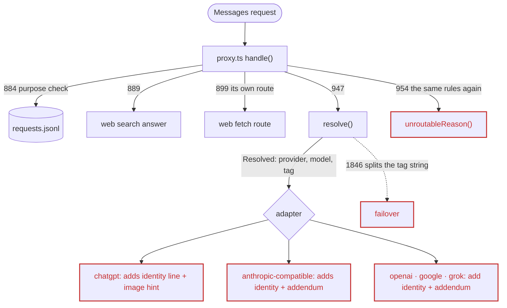
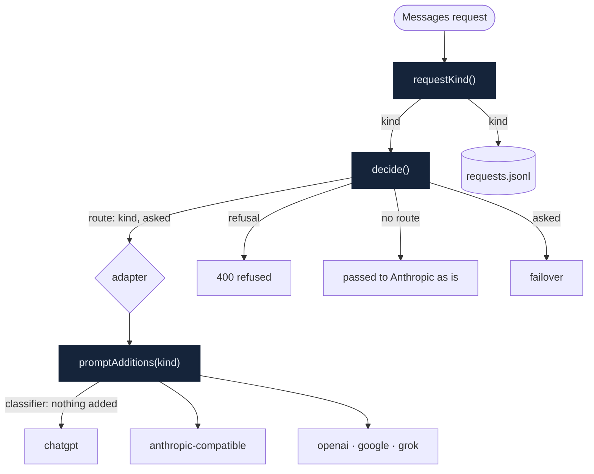
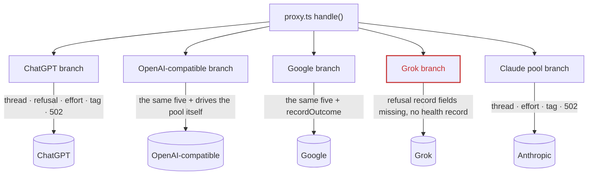
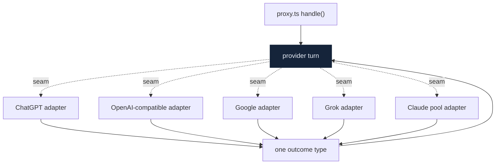
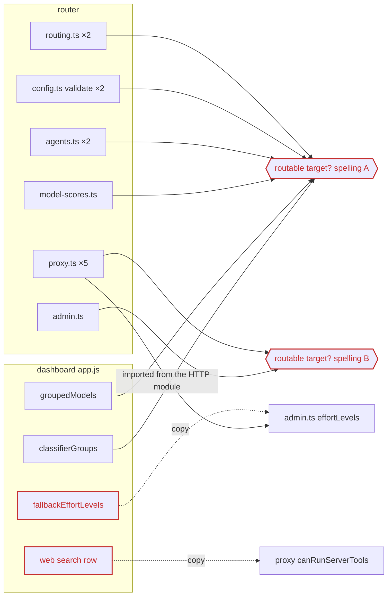
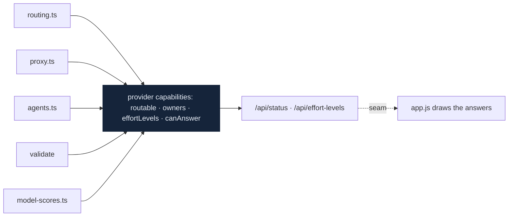
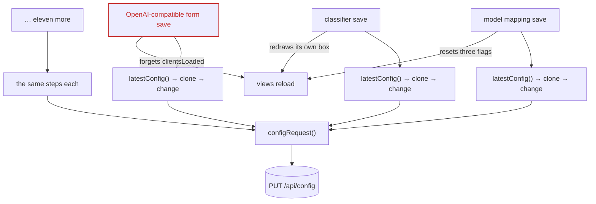
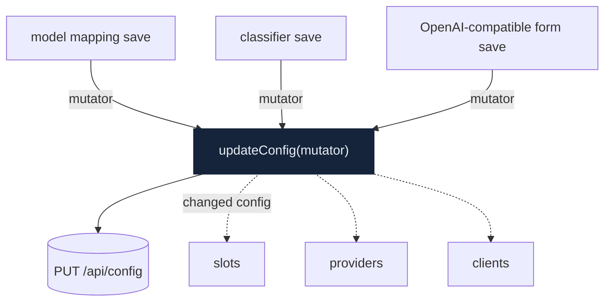
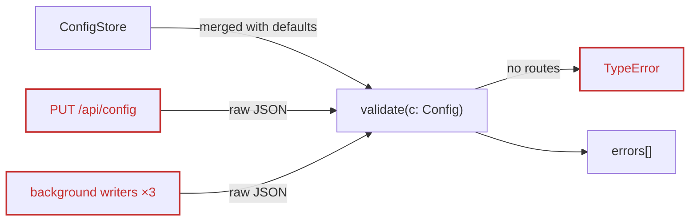
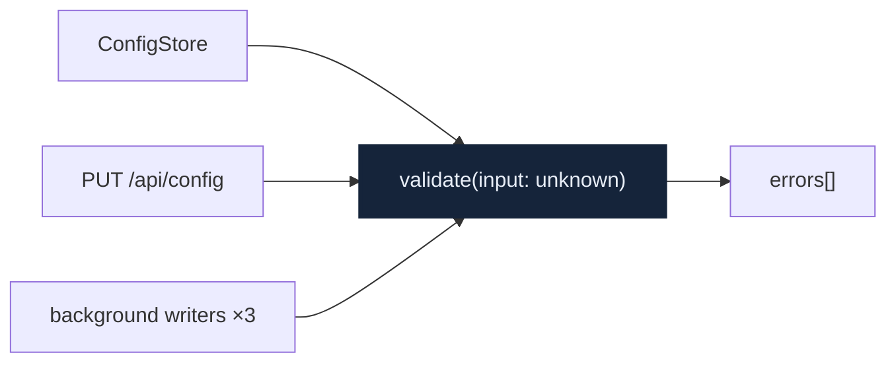

# Architecture review, 2026-10-24

A review of the router and the dashboard on `main` plus #91 (the Auto mode classifier's per-stage targets), written for the refactors that follow it. It looks for **deepening opportunities**: places where a module's interface is nearly as complex as its implementation, or where one rule is written in many places, so that a change or a bug has to be chased across files.

Vocabulary, used exactly: **module** (anything with an interface and an implementation), **interface** (everything a caller must know: types, invariants, error modes, ordering, config), **depth** (behaviour behind a small interface; *deep* is a lot, *shallow* is an interface nearly as complex as the implementation), **seam** (where an interface lives, where behaviour can change without editing in place), **adapter** (a concrete thing satisfying an interface at a seam), **leverage** (what callers get from depth), **locality** (what maintainers get from depth). In the graphs, solid arrows are calls or data, dashed arrows cross a seam, red marks a leak or a defect, and dark nodes are the deep modules.

Line numbers refer to `feat/classifier-stage1-target` at `5caeffd`, the head of #91, where the review was made.

## Verdict

Refactoring is worth doing now, for two reasons. A request's kind does not exist as a value, so it cannot reach the provider adapters; as a result the Auto mode classifier's security prompt is altered on its way to every translated provider, against ARCHITECTURE §2. And several rules about providers are written in up to sixteen places, in two spellings, with the dashboard keeping its own copies. The two `Strong` candidates below are in-process and testable as pure functions. The provider-turn and dashboard-save candidates are larger and need their own plan; the `validate` one is small.

| # | Candidate | Strength | Status |
|---|---|---|---|
| 1 | [A request's kind, decided once](#1-a-requests-kind-decided-once-and-carried-with-its-route) | Strong | in progress |
| 2 | [One provider-turn seam](#2-one-provider-turn-seam-for-the-five-provider-branches) | Worth exploring | |
| 3 | [Provider capabilities in one module](#3-provider-capabilities-answered-in-one-module) | Strong | next |
| 4 | [One config-update module in the dashboard](#4-one-config-update-module-for-the-dashboards-saves) | Worth exploring | |
| 5 | [`validate` takes raw input](#5-validate-merges-defaults-itself) | Worth exploring | |

## 1. A request's kind, decided once and carried with its route

`Strong` · `in-process` · Files: `packages/router/src/routing.ts`, `proxy.ts`, `identity.ts`, `providers/{chatgpt,openai,google,grok}`

**Before**

**After**

- **Problem**: whether a request is a classifier stage, a search, a fetch or a continue is worked out on several lines of `proxy.ts`, and the answer never reaches the adapters. So a classifier request routed to ChatGPT gets `You are gpt-6-luna (reasoning effort: high), answering through Claude Code, a terminal-based coding agent.` in front of the security prompt and the image-generation hint after it; the OpenAI-compatible, Google, Grok and Anthropic-compatible paths add the identity line and the addendum.
- **Solution**: `requestKind()` decides the kind once; `decide()` returns the route or the reason there is none, in one pass; every adapter takes what it may add from `promptAdditions(kind)`, which gives a classifier request nothing.
- **Wins**: locality, the kind is decided in one place · the security prompt really is left intact · `unroutableReason`, a second copy of `resolve`'s rules, goes · no more parsing of the log tag · the interface is a pure-function test surface.
- **ARCHITECTURE §2** promises the original security prompt stays intact. This candidate restores that decision; it does not reopen it.

## 2. One provider-turn seam for the five provider branches

`Worth exploring` · `ports & adapters` · Files: `proxy.ts` (~1034–1321), `providers/{openai,chatgpt,google,grok}`, `routing.ts` (`threadDecision`)

**Before**

**After**

- **Problem**: `proxy.ts` repeats thread policy, the refusal response, recording the effort, the log tag, the 502 path and health bookkeeping by hand for each provider, and the branches have already drifted (Grok's thread refusal lacks `refusal` and `upstreamCalled`; Grok never calls `providerHealth.observe`).
- **Solution**: one seam, "send this Messages turn to this target", with one outcome type; the five providers become adapters that translate and send.
- **Wins**: five adapters justify the seam · nowhere left for branches to drift · locality for credentials and health · turn-level tests without a TLS rig.
- **ARCHITECTURE §5**: most of the recorded failure modes (vanished requests, cache hit rate) live in these branches. Move one branch at a time.

## 3. Provider capabilities, answered in one module

`Strong` · `in-process` · Files: `routing.ts`, `proxy.ts`, `agents.ts`, `config.ts`, `model-scores.ts`, `admin.ts`, `packages/ui/app.js`

**Before**

**After**

- **Problem**: "an `anthropic` provider without `accountPool` is not a routing target" is written in sixteen places in two spellings (`accountPool` alone, or with `auth === "claude-code"`), and `validate` refuses it for fallbacks and classifier targets but lets a primary route or a direct rule through, which `resolve` then drops silently. Model ownership, effort levels and whether a target can answer a web search are also computed separately by the router and the dashboard, and their answers differ.
- **Solution**: a provider-capabilities module in the router answers "can this provider be a target, and why not", "who owns this model id", "which efforts does it take" and "can it answer this kind of request"; the dashboard receives the answers through `/api/status` and only draws them.
- **Wins**: one rule, sixteen call sites · the dashboard stops copying router rules · one place for `validate`'s refuse-or-allow policy · effort levels leave the HTTP module.
- **ARCHITECTURE**: the fallback entry already records that adding fallbacks "re-opened the §5 row about ingress-only targets". With one home for the rule it would not have reopened.

## 4. One config-update module for the dashboard's saves

`Worth exploring` · `in-process` · Files: `packages/ui/app.js` (`configRequest`, `latestConfig`, fourteen save functions), `packages/router/test/ui-*.test.ts`

**Before**

**After**

- **Problem**: fourteen save sites rewrite read-modify-write themselves; "start from `latestConfig` or the 409 rebase cannot run" is written nowhere; the OpenAI-compatible form does not reset `clientsLoaded`, so the Clients page keeps old model lists after such an edit.
- **Solution**: `updateConfig(mutator)` owns reading the latest config, the rebase, committing and telling views what changed; each view subscribes.
- **Wins**: locality for the save rules · no forgotten reloads · UI tests through an interface instead of source text.
- **Note**: `app.js` is one classic script with no modules, so splitting it comes first.

## 5. `validate` merges defaults itself

`Worth exploring` · `in-process` · Files: `packages/router/src/config.ts` (`validate`, `merge`, `DEFAULTS`), `admin.ts` (PUT `/api/config`, three background writers)

**Before**

**After**

- **Problem**: `validate` assumes a config already merged with `DEFAULTS`, but PUT `/api/config` and three background writers pass the JSON they received. A config without `routes` throws `TypeError: Cannot convert undefined or null to object` instead of returning an error list (checked by calling it).
- **Solution**: `validate` takes `unknown`, merges defaults, then checks shape and rules behind one interface.
- **Wins**: one rule fewer for callers · a partial config gets an error list · tests stop spreading `...DEFAULTS`.

## Top recommendation

[**1. A request's kind, decided once**](#1-a-requests-kind-decided-once-and-carried-with-its-route). It fixes a defect against a recorded decision right next to the code #91 touched, and gathers the cost every new request kind used to pay (several lines of `proxy.ts` plus every adapter) into one module. Its dependencies are in-process, so it is tested as pure functions without a TLS rig.

## Fine as is

These look like candidates at first sight but should be left alone.

- `resolve`'s rule order, `isAutoModeClassifier` and `isClassifierStage1`: already deep, with fast tests.
- The in-turn credential retry and the 403/402/429 read-ahead (`proxy.ts` ~1386–1579): intricate but one piece; splitting it piecemeal would break it.
- `dropForeignThinking`, `websearch.ts`, `hold.ts` and `tether.ts`, `classifierRowsOf` and `classifierSettingOf`.
